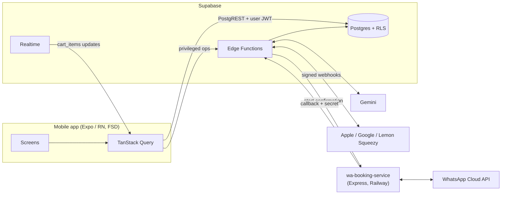

# Pixap

**Booking a table or a service at venues that have no booking API is still done by phone. Pixap books it for you: an AI concierge finds the place, then confirms availability and price with the venue over WhatsApp, voice, or email.**

<!-- TODO(stage-1): 30–60s screen recording of the booking flow: PixAI search → place → slot → WhatsApp confirmation → booked. Save as docs/media/booking-flow.gif -->
<p align="center"></p>

<p align="center">
  <a href="https://apps.apple.com/app/pixap/id6760616898">App Store</a> ·
  <a href="https://play.google.com/store/apps/details?id=com.pixap.pixap">Google Play</a> ·
  Test account: <!-- TODO: reviewer@… / password, or "on request" -->
</p>

**Stack:** Expo SDK 54 / React Native · TypeScript · TanStack Query · Supabase (Postgres + RLS, Auth, Realtime, Edge Functions on Deno) · Node/Express · Meta WhatsApp Cloud API · Gemini · Apple / Google IAP

---

## Architecture



How a booking flows:
1. The app writes a `cart_items` draft through PostgREST. RLS limits each user to their own rows.
2. `n8n-wa-booking-start` hands the draft to `wa-booking-service`, which messages the venue and parses the reply (availability, then price, then a payment link).
3. Each step is posted back to `n8n-wa-booking-callback`, which patches the cart row. The app sees the change over Realtime.
4. `confirm-service-cart-booking` turns the draft into a `bookings` row.

More detail: [system overview](docs/system-overview.md) · [API & auth reference](docs/api.md) · [frontend architecture (FSD)](docs/adr/architecture/frontend-fsd.md)

## Key engineering decisions

| Decision | Why | ADR |
| --- | --- | --- |
| **Postgres RLS instead of a CRUD API** | Ownership rules live with the data and also cover Realtime, so there's no backend to write for 80% of traffic | [0001](docs/adr/0001-rls-instead-of-custom-api.md) |
| **Edge Functions as a thin BFF** | Secrets, the LLM prompt, and multi-step writes stay on the server; the prompt can change without a store release | [0002](docs/adr/0002-edge-functions-as-bff.md) |
| **Idempotent webhooks via unique keys** | Lemon, Apple, Google, and Meta all deliver at least once; each event is claimed in the DB before any side effect | [0003](docs/adr/0003-idempotent-webhooks.md) |
| **Venue confirmation in a separate stateful service** | Venue conversations last minutes to hours, which doesn't fit stateless, short-lived functions | [0004](docs/adr/0004-whatsapp-venue-confirmation.md) |
| **Feature-Sliced Design, enforced by lint** | Features can't import each other, so each one can be read and deleted on its own | [0005](docs/adr/0005-feature-sliced-design.md) |

Security posture: every Edge Function with gateway JWT turned off authenticates the caller itself (HMAC, JWS, OIDC, a shared secret, or the user JWT), and webhook secrets fail closed. Per-function table: [docs/api.md](docs/api.md#edge-function-auth-verify_jwt--false).

## Results

| Metric | Value | Source |
| --- | --- | --- |
| Feed + stories scroll, 30 s, low-end Android (POCO C71) | 1 frame > 16 ms, 0 frames > 32 ms | [list rendering report](docs/adr/performance/list-rendering.md) |
| JS bundle (Hermes bytecode) | ~7.22 MB | [bundle-baseline.json](bundle-baseline.json) |
| Storage cached egress, before image pipeline work | ~1.2 GB / MAU (21.6 GB / 18 MAU) | [docs/EGRESS_METRICS.md](docs/EGRESS_METRICS.md) |
| Egress after pre-generated WebP + transforms | _TBD_ | stage 3 |
| AI concierge: p50 / p95 latency, booking confirmation rate | _TBD_ | stage 3 |

## Quick start

```bash
cp .env.example .env && npm install && npx expo start
```

Fill in `EXPO_PUBLIC_SUPABASE_URL` and `EXPO_PUBLIC_SUPABASE_ANON_KEY` in `.env`. Maps need a dev client build (`npx expo run:android`), because Expo Go doesn't inject native map keys. Backend setup (migrations, functions, WhatsApp service) is in [docs/system-overview.md](docs/system-overview.md) and [backend/wa-booking-service/README.md](backend/wa-booking-service/README.md).

## Known limitations & next steps

- **WhatsApp booking state is in memory.** `wa-booking-service` loses in-flight conversations and its inbound `message.id` dedup on restart, and it can't run more than one replica. Next: persist both to Postgres.
- **`transcribe-audio` is unauthenticated.** The released client sends only the anon key, so the endpoint is effectively an open speech-to-text proxy. Next: send the session token from the client, then require it on the server.
- **Almost no automated tests** (2 test files). Next: tests for the booking state machine and the webhook handlers first, since that's where money moves.
- **`pixai-orchestrate` returns illustrative slots.** Real availability comes from `get-available-slots` and venue confirmation.
- **Public auth endpoints** (`auth-email-signup`, `auth-email-recovery`) have no rate limiting.
- **US venues mostly don't use WhatsApp.** The voice (Retell) and email channels are newer and less proven.

## Further reading

- [docs/system-overview.md](docs/system-overview.md): repository layout, app layers, data model, booking flows
- [docs/api.md](docs/api.md): Edge Functions, `wa-booking-service` endpoints, auth per function, environment variables
- [docs/adr/](docs/adr/README.md): architecture decisions, performance reports, pipelines
- [docs/deep-dive/](docs/deep-dive/): PixAI booking chat, subscriptions and credits
- [docs/adr/architecture/frontend-fsd.md](docs/adr/architecture/frontend-fsd.md): FSD layers and ESLint boundaries

## License

Proprietary. See [LICENSE](LICENSE).
